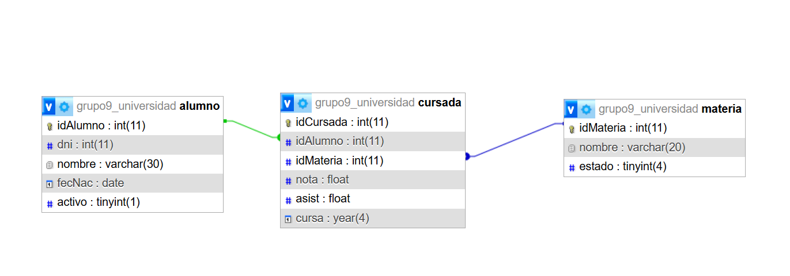

# SGULP – Sistema de Gestión para la Universidad de La Punta

**Proyecto Transversal – Laboratorio 1 – Grupo 9**

Sistema de escritorio en Java para registrar alumnos, materias e inscripciones
(cursadas) de la Universidad de La Punta, con persistencia en MariaDB mediante JDBC.

---

## 👥 Integrantes

| Apellido y Nombre             |
|-------------------------------|
| Magallanes, Franco            |
| Auriol, Jessica               |
| Martin Asis, Gonzalo Exequiel |
| Matijas, Omar                 |

---
## 📦 Contenidos

Base: **`grupo9_universidad`** (motor InnoDB)
Scripts:
- `GP9_universidad.sql` crea la base y las tablas.
- `GP9_seeder.sql` carga alumnos, materias y cursadas de prueba.

```
alumno (1) ──< cursada >── (1) materia
```

| Tabla     | Descripción                                                             |
|-----------|-------------------------------------------------------------------------|
| `alumno`  | Datos del alumno: DNI, nombre, fecha de nacimiento y estado activo      |
| `materia` | Materias que se dictan y su estado                                      |
| `cursada` | Inscripción de un alumno a una materia en un año, con nota y asistencia |

`cursada` tiene claves foráneas hacia `alumno` y `materia`.



---

## ▶️ Cómo ejecutar

### Requisitos

- JDK 17 o superior
- Apache NetBeans (proyecto Maven)
- XAMPP con MariaDB/MySQL iniciado

### Pasos

1. Iniciar **MySQL** desde el panel de XAMPP.
2. En phpMyAdmin → **Importar** → seleccionar `GP9_universidad.sql` (crea la base y las tablas).
3. (Opcional) Importar `GP9_seeder.sql` para cargar alumnos, materias y cursadas de prueba.
4. Abrir el proyecto en NetBeans.
5. Si MariaDB usa un puerto distinto a `3306` (por ejemplo `3307`), cambiar la
   constante `PORT` en `vista/MenuPrincipal.java` y/o en `vista/Grupo9_TRANSVERSAL_SGULP.java`.
6. Ejecutar:
   - **Aplicación con ventanas:** clic derecho sobre `vista/MenuPrincipal.java` → **Run File** (`Shift+F6`).
   - **Test de consola:** clic derecho sobre `vista/Grupo9_TRANSVERSAL_SGULP.java` → **Run File** (`Shift+F6`).

---

## 🧱 Estructura del proyecto

```
src/main/java/com/mycompany/grupo9_transversal_sgulp/
├── modelo/          Alumno, Materia, Cursada
├── persistencia/    miConexion, AlumnoData, MateriaData, CursadaData
└── vista/           MenuPrincipal (ventana principal), AlumnoVista, MateriaVista,
                     InscripcionVista, CursadaPorMateria,
                     Grupo9_TRANSVERSAL_SGULP (main con test de consola)
```

---
## 📝 Consideraciones del grupo – Final

- No hay registro de asistencia por día porque no hay una tabla para tal fin (así estaba el diseño original en la consigna)


## 🛠️ Tecnologías

- Java 17
- Maven
- MariaDB (XAMPP) + driver JDBC `mariadb-java-client`
- JCalendar (`JDateChooser`) para elegir la fecha de nacimiento
